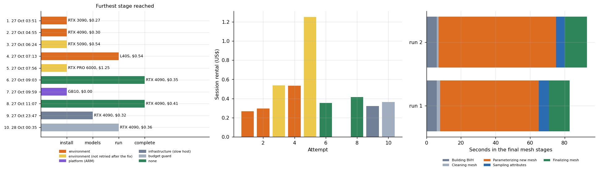

# Image to 3D and digital twin

**Ten attempts to run one open image-to-3D tool (SUPRA-Tex) on rented and owned GPUs: two finished, eight did not, and the reasons are the useful part.** Also a note on COLMAP and a local build of an open 3D room viewer.



## Why this matters

Image-to-3D is where a "does it run?" question turns into a week of work. A tool pins a CUDA toolkit, builds native extensions and downloads gated models, and every one of those steps fails differently on different hardware. A compatibility grid that says "failed" for five cards hides that four of the five failures were fixable environment problems and only one belongs to the platform. This repository keeps every attempt, classifies the cause from the logs, prices the failures and records the two runs that worked.

## Headline results

| Finding | Evidence |
|---|---|
| **2 of 10 attempts completed**, both on an RTX 4090 | 95% Wilson interval 0.06 to 0.51: with ten attempts the data cannot tell "one in five" from "one in two" |
| Only **one** failure belongs to the platform | the ARM GB10: the installer pins a wheel that exists only for x86 Linux and runs an x86 CUDA installer. The other failures were a missing toolkit, a native extension (CuMesh) that failed to build, a missing imaging library, a slow model download and my own budget guard |
| Failures cost most of the money | US$ 4.34 across all sessions, of which US$ 0.77 produced a result; 82% went to sessions that ended in an error (most also ran other tests, so this is an upper bound) |
| Where a finished run spends its time | 83 to 93 seconds in the final mesh stages, 69% to 73% of it in surface parameterization for texturing |
| What the log says about quality | silhouette overlap with the input photograph (intersection over union) 0.991; 11.4 million faces before simplification. This says the outline matches, not that the back or the texture is right |

## What is honest about this evidence

The two completions are proven by **the run log**, which ends with the path of the textured GLB file and the quality line, **not by the file**: the rented machine was destroyed before the GLB was copied off, and a later run was destroyed by my own credit guard while inference was running. No mesh is published. The logs are in `logs/` (progress bars removed). COLMAP was installed with CUDA support and its version printed on three cards, but its reconstruction test was *skipped for lack of an image dataset*; the `total_s` values of COLMAP rows in the raw sweep table are the wall time of the whole check block, not a reconstruction time, so this repository publishes no COLMAP timing.

## The room viewer

An open 3D room viewer was built from its public source on a local machine (Node.js 22): 115 modules transformed in 1.5 s, a preview server answered HTTP 200, and two pages were rendered headlessly. That shows the viewer builds and runs on laptop-class hardware, a prerequisite for showing results to customers. The viewer's demo assets may not be redistributed, so **no screenshots, models or textures from it are included**; see `data/viewer_local_check.csv`.

## Repository map

```
src/threed/    run_supra.sh, run_supra_art.sh (the install-and-run recipes), run_libs3.sh, libs.py (COLMAP check)
analysis/      attempts.py: classification, costs, stage timings, intervals
data/          supra_attempts.csv, supra_completed_runs.csv, viewer_local_check.csv
logs/          cleaned run logs of the two finished runs
results/       figures and tables;  tests/  conclusions that must keep following from the data
```

## Reproduce

```bash
make setup && make all
bash src/threed/run_supra.sh      # on an x86 CUDA machine; needs access to the gated image-encoder weights
```

## Limits

One tool, one input image, 4090 only for completions. Failures on the 3090, 5090, L40S and PRO 6000 were not retried after the 4090 fix, so those cells read "not reached", not "fails". Mesh quality beyond the silhouette was not evaluated.

## Articles that use this repository

- [Ten attempts to run an image-to-3D tool](https://www.kaggle.com/code/lucasrangelss/ten-attempts-to-run-an-image-to-3d-tool)
- [What fits and what fails across seven GPUs](https://www.kaggle.com/code/lucasrangelss/what-fits-and-what-fails-across-seven-gpus)
- Harness and costs: [vast-gpu-benchmark-harness](https://github.com/LucasRangelSSouza/vast-gpu-benchmark-harness)

Licence: MIT for this code. SUPRA-Tex and the viewer keep their own terms, see `LICENSE_NOTES.md`.
